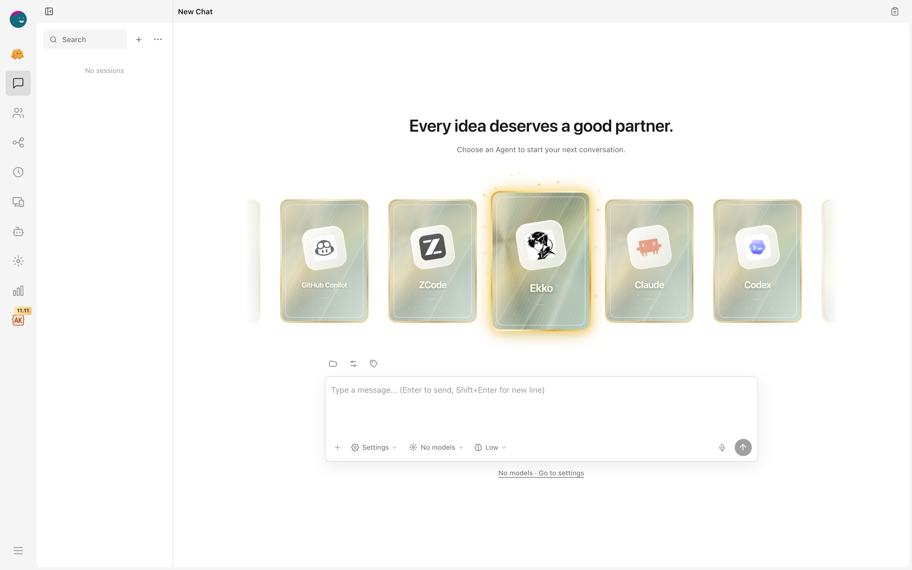
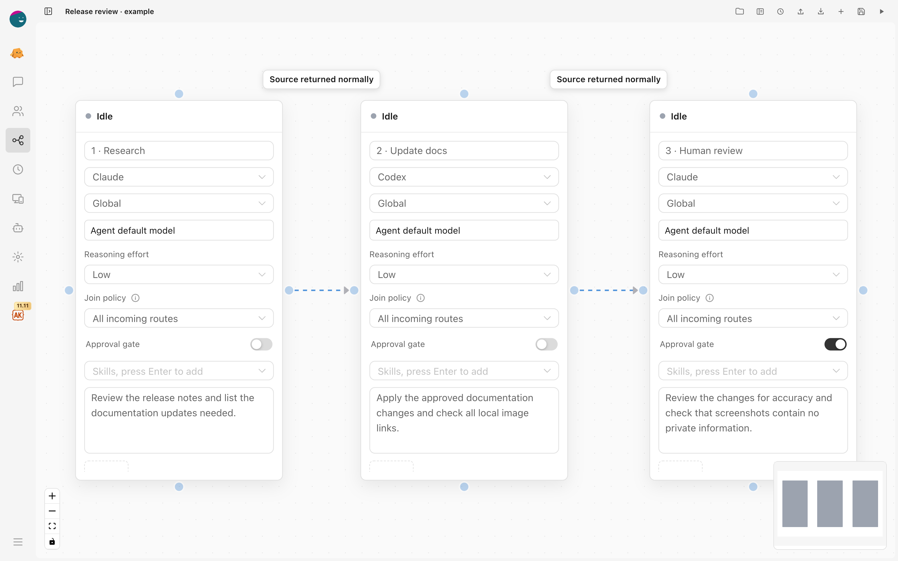
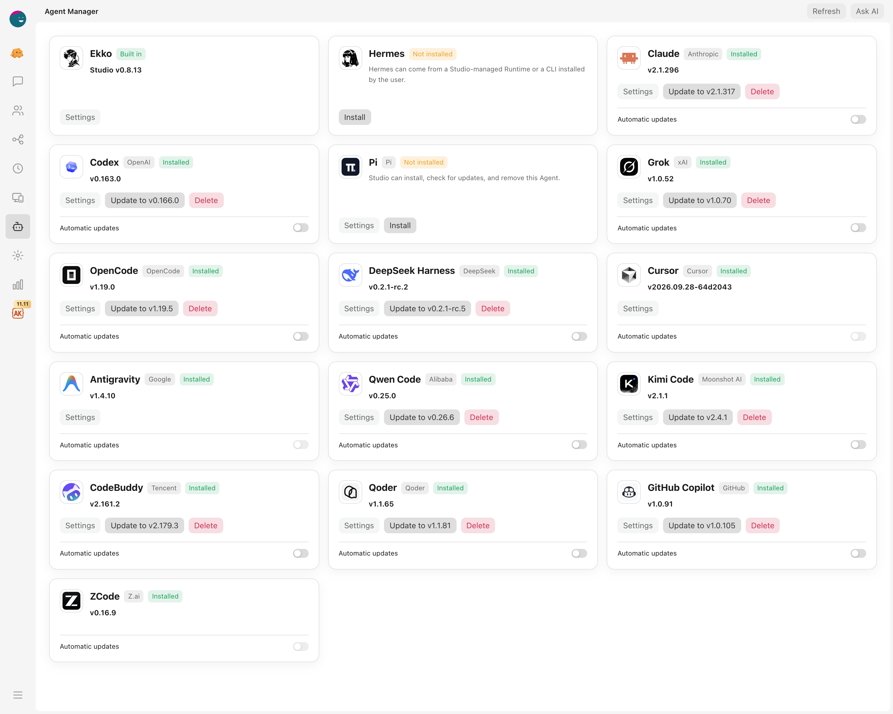

<p align="center">
  <strong>AgentHub</strong>
  <a href="./README_zh.md">中文</a>
</p>

<p align="center">
  A local-first AI workspace for multi-agent chat, coding, and visual workflows.<br/>
  Available as a desktop app and self-hosted web console, with support for<br/>
  <a href="https://github.com/NousResearch/hermes-agent">Hermes Agent</a>, Hub Agent, and 14 coding-agent integrations, including Claude Code and Codex.<br/>
  Bring conversations, group collaboration, voice, files, and workflows together in one place.
</p>

<p align="center">
  <a href="https://github.com/forhetale/agenthub/releases/latest">Download AgentHub Desktop</a>
  ·
  <a href="./CUSTOMIZATION.md">Customization &amp; Architecture</a>
  ·
  <code>git clone https://github.com/forhetale/agenthub.git</code>
</p>

<p align="center">
  
</p>

<p align="center">
  <a href="https://github.com/forhetale/agenthub/blob/main/LICENSE"></a>
  <a href="https://github.com/forhetale/agenthub/stargazers"></a>
</p>

**AgentHub** (formerly TATin Studio) is a local-first, de-commercialized fork of
[Ekko Studio](https://github.com/EKKOLearnAI/ekko-studio) (originally Hermes Studio / Hermes Web UI),
maintained at [`forhetale/agenthub`](https://github.com/forhetale/agenthub). It preserves the
`hermes-web-ui` package identity and `~/.hermes-web-ui` state directory while exposing
`agenthub` / `agenthub-mcp` commands and the built-in **Hub Agent** (`hub-agent`). See
[`CUSTOMIZATION.md`](./CUSTOMIZATION.md) for fork changes and upstream sync ledgers.

## Screenshots

Captured from **v0.8.13** source on 2026-11-03, running locally with isolated data. The workflow is an example created in the UI and has not been run; Agent statuses reflect this machine. See [capture notes](./docs/screenshots/overview/README.md).

| Visual workflows | Agent Manager |
| --- | --- |
| [](./docs/screenshots/overview/workflow.png) | [](./docs/screenshots/overview/agent-manager.png) |
| Connect agent steps and add a human approval gate; this example is not running. | Manage Agent installations, settings, and updates in one place. |

## Core Capabilities

| Area | What AgentHub does |
| --- | --- |
| Multi-agent runtime | Connects the agents listed below with streaming responses, tool traces, generated-file previews, persistent sessions, and standalone desktop chat windows. |
| Studio workspace | Provides shared chats, group chat, global-agent runs, workflows, files, voice, media, themes, logs, usage, and Bark push notifications across agent runtimes. |
| Agent control planes | Keeps Hermes and Hub Agent profiles, providers, models, memory, skills, plugins, jobs, Kanban, channels, and runtime management in their owning agent module. |
| Automation | Builds executable visual workflows and connects the supported runtimes through schedules, approval gates, group-chat rooms, platform channels, and MCP servers. |
| Workspace tools | Provides a file browser, web terminal, Desktop Agent Browser, screenshot capture, voice input/output, coding-agent runners, Journey graph, and performance views. |
| Distribution | Ships as a desktop app for Windows/macOS/Linux, source-built Node CLI (`agenthub` / `hermes-web-ui`), and Docker image. |

## Supported Agents

Single chat, group chat, and workflows share the same Agent catalog. Coding agents run on the machine hosting the Studio backend; their CLI must be installed there.

| Agents | Configuration and installation |
| --- | --- |
| Hub Agent, Hermes Agent | Hub Agent (`hub-agent`) is built in. Desktop and Docker bundle a Hermes runtime; local CLI installations discover an existing Hermes installation. |
| Claude Code, Codex, Pi, Grok, OpenCode, DeepSeek Harness (DSH) | Studio-scoped or native global configuration; installation and supported updates through Agent Manager. |
| Qwen Code, Kimi Code, CodeBuddy, GitHub Copilot CLI, ZCode | Studio-scoped or native global configuration. ZCode requires manual installation; the others support npm installation through Agent Manager. |
| Cursor, Qoder, Antigravity | Cursor and Qoder use native global configuration. Antigravity supports scoped and global launches. Cursor and Antigravity require manual installation. |

Scoped mode uses isolated session configuration; supported runtimes can use the selected Studio provider/model. Global mode uses the CLI's existing configuration and sign-in. Available models, tools, and context controls depend on the runtime.
See [native coding agents](./docs/native-coding-agents.md), [Antigravity CLI](./docs/antigravity-cli.md), and [DSH setup](./docs/dsh-management.md) for details.

## Features

### AI Chat

- Start a conversation from responsive Agent cards; Hub Agent is the initial default, and Studio remembers the last agent, model, workspace, launch mode, and reasoning options
- Real-time chat streaming over Socket.IO `/chat-run`; Studio dispatches each run to the selected runtime adapter
- Multi-session management — create, rename, delete, switch between sessions
- **Self-built session database** — local SQLite storage for Studio sessions; Hermes state.db remains a read-only source for Hermes history APIs
- Session grouping by source (Telegram, Discord, Slack, etc.) with collapsible accordion
- Active session indicator — live sessions pin to top with spinner icon
- Sessions sorted by latest message time
- Markdown rendering with syntax highlighting and code copy
- Tool call detail expansion (arguments / result)
- Profile-scoped file uploads, clipboard image/file paste, and workspace attachments
- File download support — download uploaded files and agent-generated files by resolved path across local, Docker, SSH, and Singularity backends
- Inline previews for generated HTML, PDF, DOCX, PPTX, XLSX, CSV, images, Markdown, and source files
- Session search — Ctrl+K search across the Studio local session database; read-only Hermes history sessions are not included
- Session categories, message references, compression progress, and durable background delegation results
- Persistent task cards with live step progress, approval prompts, and clarification questions
- Profile-aware model selector with runtime-specific provider/model availability
- Per-turn token usage, cache hits, estimated cost, and generation speed; supported runtimes also expose context usage and compression controls

### Platform Channels

Unified configuration for **10 platforms** in one page:

| Platform      | Features                                                               |
| ------------- | ---------------------------------------------------------------------- |
| Telegram      | Bot token, mention control, reactions, free-response chats             |
| Discord       | Bot token, mention, auto-thread, reactions, channel allow/ignore lists |
| Slack         | Bot token, mention control, bot message handling                       |
| WhatsApp      | Enable/disable, mention control, mention patterns                      |
| Matrix        | Access token, homeserver, auto-thread, DM mention threads              |
| Feishu (Lark) | App ID / Secret, mention control                                       |
| DingTalk      | Client ID / Secret, mention control                                    |
| QQBot         | App ID / Secret, mention control                                       |
| WeChat        | QR code login (scan in browser, auto-save credentials)                 |
| WeCom         | Bot ID / Secret                                                        |

- Credentials and channel behavior settings write to `.env` and `config.yaml` under the selected Hermes profile
- Per-platform configured/unconfigured status detection
- Gateway autostart is opt-in under Hermes settings; ordinary Studio chat does not require a platform Gateway

### Usage Analytics

- Total token usage breakdown (input / output)
- Session count with daily average
- Estimated cost tracking & cache hit rate
- Model usage distribution chart
- 30-day daily trend (bar chart + data table)

### Scheduled Jobs

- Create, edit, pause, resume, delete cron jobs
- Trigger immediate execution
- Cron expression quick presets

### Kanban

- Profile-aware Kanban board for planning and tracking agent work
- Task creation, updates, and status movement from the dashboard
- Uses the Hermes Kanban CLI and its task storage, with Studio authentication and profile access controls

### Visual Workflows

- Vue Flow canvas for the supported Agent catalog, with file/image attachments and runtime-specific launch settings
- Directed edges, structured conditions, success/failure routes, loops, and approval gates
- Import/export for portable workflow definitions and profile-aware workspaces
- Run budgets, deadlines, stop/rerun controls, and persisted execution history
- Frozen run snapshots, node conversations, edge decisions, and evidence playback on the canvas

### Model Management

- Auto-discover models from credential pool (`~/.hermes/auth.json`)
- Fetch available models from each provider endpoint (`/v1/models`)
- Add, update, and delete providers (preset and custom OpenAI-compatible)
- OAuth/device flows for OpenAI Codex, Nous Portal, xAI, Claude, and GitHub Copilot
- Provider URL auto-detection for non-v1 API versions (e.g. `/v4`)
- Provider-level model grouping, visible-model controls, aliases, refresh, and default switching
- Separate STT and TTS provider catalogs under Models

### Multi-Profile

- Create, rename, delete, and switch between Hermes profiles
- Clone existing profile or import from archive (`.tar.gz`)
- Export profile for backup or sharing
- Profile-scoped configuration, cache, uploads, sessions, jobs, usage, memory, skills, plugins, providers, and model visibility
- Account-bound profile access: super administrators can manage every profile; regular administrators only see and use profiles assigned to their account

### File Browser

- Browse files on remote backends (local, Docker, SSH, Singularity)
- Upload, download, rename, copy, move, and delete files
- Store uploaded files under the selected/requested Hermes profile while keeping downloads path-based for agent-generated artifacts outside the upload directory
- Create directories
- Preview and edit supported files with syntax highlighting, then attach workspace files back to a chat

### Group Chat

- Multi-agent chat rooms with real-time messaging via Socket.IO
- @mention routing — mention an agent to trigger a contextual reply
- Context compression — automatic conversation summarization when history exceeds token threshold
- Typing status and reply progress indicators
- Room creation, deletion, and invite code management
- Agent management — add/remove agents from rooms with per-agent profiles
- SQLite message persistence
- Mobile responsive with collapsible sidebar

### Coding Agents

- Detect, configure, launch, and monitor the 14 coding-agent integrations listed above; install and update supported CLIs from Agent Manager
- Built-in coding-agent terminal, session history, workspace selection, images, and file diffs
- Dedicated proxy routes and API modes for provider/model compatibility
- Standalone desktop chat windows and persisted output/reasoning metadata
- Shared `~/.agents/skills` entries are read-only in Coding Agent pages; runtime-specific settings, private skills, and MCP controls vary by agent

#### DeepSeek Harness (DSH)

- Use DSH in single chats, group-chat rooms, and workflow nodes, with Studio-selected providers/models or native global configuration.
- Select an Agent preset when creating a chat, adding a group member, or configuring a workflow node; resumed conversations retain their selected preset.
- Reuse the native `web` profile’s plugins. **Plugin configuration** embeds the plugins’ own settings UI with light/dark theme support; **Plugin list** manages installed packages. Agent presets have a separate Studio management page.
- Manage DSH settings, instructions, MCP, and private skills. Shared `~/.agents/skills` entries are display-only in every Coding Agent page; editing and deletion are blocked.

Install DSH on the machine running the Studio backend through Agent Manager. Native plugin installation requires `pnpm` on that machine’s PATH. See [DSH setup, profiles, and compatibility](docs/dsh-management.md) for details.

### Desktop Agent Browser

- Desktop-only multi-tab browser that agents can navigate through the managed MCP server
- Isolated browser profiles, per-tab control leases, proxy settings, downloads, cookies, and permissions
- Accessibility snapshots, screenshots, console logs, and page annotations for agent-assisted browsing
- Bounded page queries and sequential action batches, with observations of changed text, selected values, and newly opened tabs

### Push Notifications (Bark)

- Per-user isolated Bark push settings under **Push Notifications**, with URL parsing (`server` + `deviceKey`), custom sound/group, and encrypted key storage at rest
- Sends notifications for run completion, approval prompts, and clarification questions (interrupts do not notify; clicks never auto-approve)
- Configurable notification language (defaults to Chinese) alongside optional final-reply summary previews (up to 160 characters)

### JEV Evaluation

- Profile-scoped evaluation settings for memory recall, skill matching, and learning
- Optional browser-action, group-chat, and workflow assessments with independent controls

See [JEV configuration and integration status](./docs/jev.md).

### Skills & Memory

- Browse and search installed skills
- View skill details and attached files
- Install and manage Skill Bundles with profile-aware usage statistics
- User notes, persistent Hub Agent memory, and profile-scoped memory management
- Interactive Journey graph for skill/memory relationships, category filtering, detail inspection, and playback

### Theme Customization

- Light/dark mode, interface style, base font size, text color, and active color
- Per-account background images and live preview across the workspace

### Logs

- View agent / server / error logs
- Filter by log level, log file, and keyword
- Structured log parsing with HTTP access log highlighting

### Admin & Runtime Management

- MCP manager for the managed `agenthub-*` servers, profile injection, and `api` / `browser` / `use` / `interaction` / `plugins` toolsets; task plans and clarification use the dedicated `agenthub-interaction` server
- Runtime version management; isolated Studio version previews are provided by the independent Version Preview plugin
- Performance monitor views for super administrators

### Authentication

- Token-based auth (auto-generated on first run or set via `AUTH_TOKEN` env var)
- Username/password login with account management in Settings
- Default bootstrap credentials are `admin` / `123456`; users are prompted after login to change the default username and password
- Super administrators can manage users and profile bindings; regular administrators can manage their own account details

CLI maintenance commands:

```bash
# Delete persisted login IP lock records
agenthub clear-login-locks

# Delete login locks and restart the running Studio server
agenthub clear-login-locks --restart

# Create or reset the default super administrator login to admin / 123456
agenthub reset-default-login
```

`clear-login-locks` removes `${HERMES_WEB_UI_HOME:-~/.hermes-web-ui}/.login-lock.json`. If the server is running, restart it to clear in-memory lock state. `reset-default-login` updates the Studio account database; if an `admin` user already exists, its password is reset to `123456` and the account is enabled as a super administrator.

### Settings

- Display (streaming, compact mode, reasoning, cost display)
- Agent (max turns, timeout, tool enforcement)
- Memory (enable/disable, char limits)
- Session reset (idle timeout, scheduled reset)
- Privacy (PII redaction)
- Model settings (default model & provider)
- Profile and provider configuration

### Voice / TTS / STT

- Manage voice providers under Models → STT and Models → TTS; existing Settings → Voice links redirect there.
- TTS adapters: Edge, OpenAI-compatible, MiMo, Doubao, ElevenLabs, Gemini, xAI, Mistral, MiniMax, and DeepInfra.
- STT adapters: Browser, OpenAI-compatible, Doubao, Groq, Mistral, xAI, ElevenLabs, and DeepInfra.
- Use editable turn-based voice input from the chat mic, or open the full-screen real-time voice stage for a continuous voice-focused experience.
- Provider keys and MiMo voice-clone audio stay server-side; the browser receives only masked secret status.
- Starting a new voice turn stops current assistant playback first, but does not implicitly cancel an active agent run.
- For supported settings, security notes, and current non-goals, see [`docs/voice-dialogue.md`](./docs/voice-dialogue.md).
- The real-time stage does not claim simultaneous full-duplex listen/speak; telephony and always-on wake-word listening remain out of scope.

### Web Terminal

- Integrated terminal powered by node-pty and @xterm/xterm
- Multi-session support — create, switch between, and close terminal sessions
- Real-time keyboard input and PTY output streaming via WebSocket
- Window resize support

### Desktop App & Updates

- Native Electron shell for Windows, macOS, and Linux
- Bundles the Studio runtime and starts the local server automatically
- Capture a screen region, annotate it, and attach it to single or group chat; configure an optional global screenshot shortcut
- Hide Studio during capture on supported Windows/macOS setups; Linux capture uses X11 or the system Screenshot Portal according to the desktop environment
- Custom `-agenthub.` desktop builds disable automatic upstream downloads/installs and explain how to update by rebuilding from source
- Uses GitHub Releases (`https://github.com/forhetale/agenthub/releases/latest/download`) when an official non-custom update feed is enabled
- Windows upgrades close an existing `AgentHub.exe` process before replacing files and migrate legacy `Ekko Studio.exe` / `Hermes Studio.exe` startup entries

---

## Quick Start

### Desktop App (Recommended)

Download the latest **AgentHub** desktop installer from
[GitHub Releases](https://github.com/forhetale/agenthub/releases/latest), or build locally (see [`packages/desktop/README.md`](./packages/desktop/README.md)).

Desktop builds are published for macOS, Windows, and Linux, with separate
architecture assets where applicable. The desktop app bundles the Studio
runtime and stores Hermes Agent data in `~/.hermes` on Windows, macOS, and Linux.

The desktop wrapper stores its own Studio state separately in
`~/.hermes-web-ui` unless `HERMES_WEB_UI_HOME` is set.

After the packaged desktop app starts, it installs managed command shims so the
desktop app, bundled Hermes Agent CLI, and bundled server CLI do not conflict:

| Command | Description |
| --- | --- |
| `agenthub` | Open the AgentHub desktop app |
| `agenthub cli ...` | Run the bundled Hermes Agent CLI |
| `agenthub web ...` | Run the bundled `hermes-web-ui` command |
| `agenthub -h` | Show wrapper help |
| `agenthub-mcp [api\|browser\|use\|interaction\|plugins]` | Run one managed Studio MCP toolset |

The desktop command is `agenthub`; previous managed `ekko-studio` / `hermes-studio`
shims are removed when the new shim is installed.

Use `agenthub cli -h` for Hermes Agent CLI help and
`agenthub web -h` for server CLI help. `agenthub-mcp` defaults to the
`api` toolset; choose `browser`, `use`, `interaction`, or `plugins` to keep the exposed MCP
surface focused on the current task.

### Local CLI (Built from Source)

```bash
git clone https://github.com/forhetale/agenthub.git
cd agenthub
npm install
npm run build
npm link   # exposes agenthub, hermes-web-ui, agenthub-mcp, hermes-web-ui-mcp
agenthub start
```

> **Note:** Do not run `npm install -g hermes-web-ui` to update an AgentHub installation — the npm registry package is the upstream release, not this fork. Build or pack locally from source instead. User data remains in `~/.hermes-web-ui`.

Open **http://localhost:8648**

Requires Node.js **23 or newer**. Hub Agent is included; to use Hermes Agent, install its runtime on the same machine or use the bundled Desktop/Docker distribution.

### Docker Compose

Single-container deployment with integrated Hermes Agent:

```bash
# Build from source (recommended for AgentHub)
docker compose up -d --build

# Or specify an image built from this fork
WEBUI_IMAGE=agenthub-local:latest docker compose up -d

docker compose logs -f hermes-webui
```

Open **http://localhost:6060**

- Persistent Hermes data is stored in `./hermes_data`
- Studio auth token is stored in `./hermes_data/hermes-web-ui/.token`
- On first run with auth enabled, the token is printed to container logs
- All runtime settings are environment-variable driven in `docker-compose.yml`

For detailed notes and troubleshooting, see [`docs/docker.md`](./docs/docker.md).

### Hermes Agent Runtime Discovery

When Studio starts backend chat features, it prefers a source checkout that
contains `run_agent.py` such as `~/.hermes/hermes-agent`. If no source checkout
is found, it falls back to the Python environment used by the installed
`hermes` command, then the system Python. This supports both source installs
and package installs such as `pip install hermes-agent`.

## Studio Environment Variables

These variables configure AgentHub, its local Hermes runtime integration, and development/preview helpers. Provider API keys and Hermes Agent settings are normally managed through Hermes profiles; environment variables here are process-level overrides.

| Variable | Default | Description |
| --- | --- | --- |
| `PORT` | `8648` | Studio server listen port. |
| `BIND_HOST` | `0.0.0.0` | Studio server bind host. Set `::` explicitly for IPv6. |
| `HERMES_WEB_UI_HOME` | `~/.hermes-web-ui` | Studio data home for auth token, credentials, logs, DB, and default uploads. `HERMES_WEBUI_STATE_DIR` is also supported as a compatibility alias. |
| `HERMES_WEBUI_STATE_DIR` | unset | Compatibility alias for `HERMES_WEB_UI_HOME`. |
| `HERMES_WEB_UI_DISABLE_MCP_AUTOINJECT` | unset | Disable startup injection of the managed `agenthub-*` MCP servers into Hermes profile configs. |
| `HERMES_WEB_UI_ALLOW_TRANSIENT_MCP_AUTOINJECT` | unset | Allow managed MCP injection when `HERMES_WEB_UI_HOME` is under a temporary directory, such as Version Preview runtimes. |
| `UPLOAD_DIR` | `$HERMES_WEB_UI_HOME/upload` | Upload root override. Files are stored below profile-scoped subdirectories. |
| `CORS_ORIGINS` | same host only | Comma- or space-separated cross-origin allowlist for HTTP, Socket.IO, and WebSocket requests. Set `*` only when you intentionally need legacy wildcard CORS. |
| `AUTH_TOKEN` | auto-generated | Explicit bearer token. If unset, Studio creates one under `HERMES_WEB_UI_HOME`. |
| `AUTH_JWT_SECRET` | `AUTH_TOKEN` | JWT signing secret override for username/password sessions. |
| `HERMES_WEB_UI_AUTH_JWT_EXPIRES_IN` | `30d` | Username/password session JWT lifetime. Accepts seconds or `s`/`m`/`h`/`d` suffixes, for example `12h` or `7d`. |
| `PROFILE` | `default` | Startup/default Hermes profile. Runtime requests use the profile selected by the frontend and authorized for the current account. |
| `LOG_LEVEL` | `info` | Server log level. |
| `BRIDGE_LOG_LEVEL` | `$LOG_LEVEL` or `info` | Bridge log level. |
| `MAX_DOWNLOAD_SIZE` | `200MB` | Maximum file download size. |
| `MAX_EDIT_SIZE` | `10MB` | Maximum editable file size. |
| `WORKSPACE_BASE` | current user's home directory | Base directory for workspace browsing. |
| `HERMES_HOME` | `~/.hermes` | Hermes data home on Windows, macOS, and Linux. |
| `HERMES_BIN` | `hermes` | Custom Hermes CLI binary path. |
| `HERMES_AGENT_ROOT` | auto-discovered | Hermes Agent source checkout containing `run_agent.py`. |
| `HERMES_AGENT_BRIDGE_PYTHON` | auto-discovered | Python interpreter used to launch the agent bridge. |
| `HERMES_AGENT_BRIDGE_UV` | auto-discovered | `uv` executable used to launch the agent bridge when available. |
| `UV` | auto-discovered | Fallback `uv` executable path. |
| `PYTHON` | auto-discovered | Fallback Python executable for the agent bridge. |
| `HERMES_AGENT_BRIDGE_ENDPOINT` | platform default | Agent bridge broker endpoint. Windows defaults to `tcp://127.0.0.1:18765`; macOS/Linux defaults to `ipc:///tmp/hermes-agent-bridge.sock`. |
| `HERMES_AGENT_BRIDGE_TIMEOUT_MS` | `120000` | Timeout for Node requests to the bridge broker. |
| `HERMES_AGENT_BRIDGE_CONNECT_RETRY_MS` | `5000` | Short retry window for connecting to the bridge socket. |
| `HERMES_AGENT_BRIDGE_STARTUP_TIMEOUT_MS` | `120000` | Timeout while waiting for the Python bridge to become ready. |
| `HERMES_DSH_READY_TIMEOUT_MS` | `180000` | DSH configuration helper startup/readiness budget in milliseconds, including its native authentication/frontend probes. Set a positive integer up to `2147483647`; invalid values use the default. For slower plugin-heavy starts, use e.g. `360000`. The two per-request probe timeouts stay at 5 seconds. |
| `AGENTHUB_DSH_ACP_TIMEOUT_MS` | `60000` | Per-request budget for DSH ACP initialization, session creation/restoration and configuration. For slow starts, use e.g. `240000`. Prompt generation has no request timeout; session close keeps its separate 10-second budget. Compatibility aliases: `EKKO_STUDIO_DSH_ACP_TIMEOUT_MS`, `HERMES_DSH_ACP_TIMEOUT_MS`. |
| `AGENTHUB_ACP_TIMEOUT_MS` | `60000` | Independent per-request budget for other native ACP agents' initialization, session creation/restoration and model/effort selection. Prompt generation has no request timeout. Compatibility aliases: `EKKO_STUDIO_ACP_TIMEOUT_MS`, `HERMES_ACP_TIMEOUT_MS`. |
| `AGENTHUB_AGENT_MODEL_DISCOVERY_TIMEOUT_MS` | `20000` | Total deadline for each native model-discovery subprocess, across all request/response exchanges, independent of both ACP chat request budgets. For slow discovery, use e.g. `240000`. An explicit internal `timeoutMs` override takes precedence over all environment aliases. Compatibility aliases: `EKKO_STUDIO_AGENT_MODEL_DISCOVERY_TIMEOUT_MS`, `HERMES_AGENT_MODEL_DISCOVERY_TIMEOUT_MS`. |
| `HERMES_AGENT_BRIDGE_STOP_ON_SHUTDOWN` | enabled | Stop the bridge broker during Studio shutdown and restart. Set `0`, `false`, `no`, or `off` to keep the bridge across restarts. |
| `HERMES_AGENT_BRIDGE_AUTO_RESTART` | enabled | Auto-restart the bridge broker after unexpected exit. Set `0`, `false`, `no`, or `off` to disable. |
| `HERMES_AGENT_BRIDGE_RESTART_DELAY_MS` | `1000` | Base delay for bridge auto-restart backoff. |
| `HERMES_AGENT_BRIDGE_PLATFORM` | `cli` | Platform identity passed to Hermes Agent. |
| `HERMES_AGENT_BRIDGE_WORKER_TRANSPORT` | platform default | Profile worker transport. Set `tcp` for loopback TCP or `ipc`/`unix` for Unix domain sockets; defaults to Windows TCP and macOS/Linux IPC. |
| `HERMES_AGENT_BRIDGE_WORKER_PORT_BASE` | `18780` | Base port for TCP worker endpoints. |
| `HERMES_BRIDGE_PROVIDER` | profile/default | Provider override for bridge runs. |
| `HERMES_BRIDGE_TOOLSETS` | profile/default | Toolset override for bridge runs. |
| `HERMES_BRIDGE_MAX_TURNS` | profile/default | Maximum turn override for bridge runs. |
| `HERMES_BRIDGE_SUPPRESS_PLATFORM_HINT` | `cli` | Controls bridge platform hint suppression passed to Hermes Agent. |
| `HERMES_OPENROUTER_APP_REFERER` | unset | Optional OpenRouter attribution referer sent by Hermes bridge runs (unset by default in AgentHub). |
| `HERMES_OPENROUTER_APP_TITLE` | unset | Optional OpenRouter attribution title sent by Hermes bridge runs (unset by default in AgentHub). |
| `HERMES_OPENROUTER_APP_CATEGORIES` | `cli-agent,personal-agent` | OpenRouter attribution categories sent by bridge runs. |
| `HERMES_WEB_UI_MANAGED_GATEWAY` | enabled | Controls Studio-managed Hermes gateway process handling. Set `0`, `false`, `no`, or `off` to use `hermes gateway start` instead. |
| `HERMES_WEB_UI_DISABLE_GATEWAY_AUTOSTART` | unset | Override the opt-in Hermes Gateway autostart policy. Set `1`, `true`, `yes`, or `on` to disable startup checks and configuration-driven reconciliation even when enabled in settings. |
| `HERMES_WEB_UI_DISABLE_SKILL_INJECTION` | unset | Skip startup bundled skill injection. Set `1`, `true`, `yes`, or `on` when bundled skills are managed outside Studio. When injection is enabled, Studio updates only skills it previously installed or identical existing bundled copies; local edits and user-owned same-name skills are skipped. |
| `HERMES_WEB_UI_STOP_GATEWAYS_ON_SHUTDOWN` | enabled | Controls whether Studio shutdown also stops only the gateway processes started and tracked by this Studio process. Set `0` or `false` to detach them; externally discovered gateways are never adopted or stopped. |
| `HERMES_WEB_UI_SHUTDOWN_FORCE_EXIT_MS` | `10000` | Short cleanup budget before Studio force-stops its owned process trees and exits. |
| `HERMES_DESKTOP_STOP_TIMEOUT_MS` | `20000` | Desktop host's existing outer deadline before it force-stops the complete Web UI process tree; independent from the Web UI's 10-second cleanup budget. |
| `HERMES_GATEWAY_URL` / `GATEWAY_URL` | unset | Explicit Hermes gateway upstream URL for proxy routes. |
| `GATEWAY_HOST` | `127.0.0.1` | Default Hermes gateway upstream host for proxy routes. |
| `GATEWAY_PORT` | `8642` | Default Hermes gateway upstream port for proxy routes. |
| `HERMES_WEB_UI_PREVIEW_REPO` | package repository | GitHub repository used by Version Preview. |
| `HERMES_WEB_UI_PREVIEW_AGENT_BRIDGE_TRANSPORT` | platform default | Version Preview broker transport. Set `tcp` to use loopback TCP for Preview on macOS/Linux; when unset, Preview follows `HERMES_AGENT_BRIDGE_WORKER_TRANSPORT=tcp`. |
| `HERMES_WEB_UI_PREVIEW_AGENT_BRIDGE_ENDPOINT` | isolated preview endpoint | Directly overrides the Version Preview broker endpoint. |
| `HERMES_WEB_UI_BACKEND_PORT` | `8648` | Backend port used by the Vite dev proxy. |
| `HERMES_WEB_UI_FRONTEND_PORT` | `8649` | Frontend Vite dev server port. |

For the three `AGENTHUB_*_TIMEOUT_MS` settings above, Studio uses the first
valid value: the `AGENTHUB_*` name, then legacy `EKKO_STUDIO_*` / `HERMES_*` compatibility aliases, then the
listed default. Values are converted with `Number` and must be integer
milliseconds in `1..2147483647`; missing, empty, zero, negative, fractional,
non-finite or overflowing values are skipped. This preserves legacy numeric
parsing (including surrounding whitespace, scientific notation and hexadecimal).
The old names remain supported; existing `HERMES_DSH_READY_TIMEOUT_MS`, state
paths, authentication and Hermes Agent settings are unchanged.

Set them in the **Studio server process environment** and restart the server.
For CLI installs, for example: `AGENTHUB_DSH_ACP_TIMEOUT_MS=240000 agenthub restart`.
For Desktop, fully quit the app and launch it with the variables in its environment;
remote Desktop clients must configure the remote server. Adding them only to a
Hermes profile's `.env` or to an agent subprocess does not configure Studio's
parent-process timers. The supplied [Docker Compose setup](docs/docker.md)
forwards both new and legacy names from the shell or Compose `.env`; recreate the
container after changing them. With `docker run`, pass them explicitly using `-e`.

### CLI Commands

`hermes-web-ui` remains an alias for the `agenthub` commands below.

| Command | Description |
| --- | --- |
| `agenthub start [port]` | Start in background; accepts a positional port or `--port <port>` |
| `agenthub client [port]` | Start for a remote client with gateway autostart disabled and permissive CORS |
| `agenthub restart [port]` | Restart; stops the bridge by default |
| `agenthub stop` | Stop the background process |
| `agenthub status` | Check if running |
| `agenthub clear-login-locks [--restart]` | Clear persisted login locks, optionally restart |
| `agenthub reset-default-login` | Create or reset the default administrator login |
| `agenthub update` / `upgrade` | Protected on `-agenthub.` / `-tatin.` custom builds (refuses overwriting with upstream npm releases) |
| `agenthub version` / `-v` | Show the version |
| `agenthub -h` | Show help |
| `hermes-web-ui-mcp [api\|browser\|use\|interaction\|plugins]` | Run one managed Studio MCP toolset (same as `agenthub-mcp`) |

Add `--no-open` to `start` or `client` when no browser should open.

`restart`, `update`, and `upgrade` stop the Agent Bridge broker by default so restarted or updated servers do not reuse stale Python bridge processes. Set `HERMES_AGENT_BRIDGE_STOP_ON_SHUTDOWN=0` before restarting only when you explicitly want to keep the bridge broker and running bridge sessions alive.

On custom `-agenthub.` / `-tatin.` builds, `update` / `upgrade` and the Web UI version check refuse to pull upstream `hermes-web-ui@latest` packages so customizations are preserved; rebuild from source to upgrade.

### Auto Configuration

On startup the BFF server automatically:

- Initializes Studio data directories, local databases, and bundled skills
- Starts the Hermes agent bridge when a Hermes runtime is available; Gateway autostart follows the opt-in Hermes setting
- Opens a browser on successful startup unless `--no-open` is set

---

## Development

```bash
git clone https://github.com/forhetale/agenthub.git
cd agenthub
npm install
npm run dev
```

- Frontend: http://localhost:8649
- BFF Server: http://localhost:8647

```bash
npm run harness:check
npm run test
npm run build   # outputs to dist/
```

See [DEVELOPMENT.md](./DEVELOPMENT.md) for contributor commands and
[ARCHITECTURE.md](./ARCHITECTURE.md) for the complete package and state model.

## Architecture

```text
Browser / Desktop
          │ HTTP + Socket.IO
          ▼
Koa bootstrap (composition only)
          │
          ├─ Studio platform ── chat, groups, global agent, workflows,
          │                    sessions, files, voice, notifications, webhooks
          ├─ Hermes family ─── profiles, models, skills, memory, jobs,
          │                    Kanban, channels, terminal, Hermes bridge
          ├─ Hub Agent family ─ Hub Agent runtime and agent-owned services
          └─ Coding family ─── coding-agent adapters, scoped config, native CLI execution
```

The server is organized by business ownership under
`packages/server/src/modules/{studio,hermes,hub-agent,coding-agents}`. Routes stay
thin, controllers own HTTP concerns, services own reusable behavior, and only
`packages/server/src/bootstrap` may compose concrete modules and adapters.
Cross-agent code belongs to Studio; an agent module must not absorb a shared
product surface merely because it uses that agent today.

Studio state and Hermes Agent state remain separate. Studio defaults to
`~/.hermes-web-ui`; Hermes profile data remains under the Hermes home. For the
full ownership tree, dependency rules, and API migration contract, see
[`docs/harness/server-module-boundaries.md`](./docs/harness/server-module-boundaries.md).

## Tech Stack

**Frontend:** Vue 3 + TypeScript + Vite + Naive UI + Pinia + Vue Router + vue-i18n + SCSS + markdown-it + highlight.js

**Backend:** Koa 2 + Socket.IO + SQLite + node-pty

## License

[BSL-1.1](./LICENSE)

The license covers AgentHub (derived from Ekko Studio / `hermes-web-ui`),
desktop applications, release artifacts, documentation, and associated files in
this repository.

The MCP entry point is `bin/agenthub-mcp.mjs`; tools use the `agenthub_*` prefix. Existing `hermes-studio-mcp` / `hermes-web-ui-mcp` commands and `hermes_studio_*` calls remain compatible. Restart the MCP client to discover the new tool names. Studio migrates managed server configurations to `agenthub-api`, `agenthub-browser`, `agenthub-use`, `agenthub-interaction`, and `agenthub-plugins`.

## Privacy

Read the [Privacy Notice](PRIVACY.md) before configuring providers, agents or integrations.
